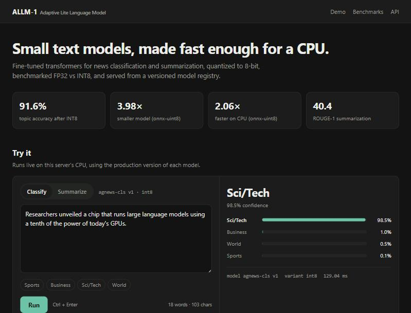

# ALLM-1 — Adaptive Lite Language Model

Small transformer models for **news classification** and **summarization**, fine-tuned,
quantized to 8-bit, benchmarked FP32 vs INT8 on CPU, and served from a versioned model registry.

**[Live demo](https://pranav-sri-vasthav-tenali-gnana--allm-1-web.us-east.modal.run/)** ·



## Results

**Topic classification** — DistilBERT on AG News (4 classes, 2,000 test articles)

| Variant | Accuracy | Macro-F1 | Size | CPU latency, 1 input | CPU latency, batch 32 |
|---|---|---|---|---|---|
| FP32 | 91.7% | 0.918 | 255 MB | 54 ms | 1.59 s |
| **INT8 (PyTorch, served)** | 91.6% | 0.917 | 132 MB (**1.9× smaller**) | 34 ms (**1.6× faster**) | 0.97 s (**1.6× faster**) |
| uint8 (ONNX Runtime) | 91.8% | 0.919 | 64 MB (**4.0× smaller**) | 26 ms (**2.1× faster**) | 1.20 s |

**Summarization** — T5-small on CNN/DailyMail (500 validation articles)

| Variant | ROUGE-1 | ROUGE-2 | ROUGE-L | Size | CPU latency, 1 article |
|---|---|---|---|---|---|
| **FP32 (served)** | 40.4 | 19.5 | 29.4 | 231 MB | 1.2 s |
| INT8 (PyTorch) | 34.3 | 14.3 | 24.6 | 121 MB | 2.5 s |

**Key finding:** post-training INT8 is nearly free for the encoder classifier
(−0.1 accuracy points), but costs ~6 ROUGE-1 on T5 and is *slower*. T5's
activation outliers lose precision under per-tensor 8-bit rounding, and
token-by-token decoding makes each matmul too small for INT8 to pay off. So the
registry serves **INT8 for classification and FP32 for summarization**.

CPU: 8th/9th-gen Intel laptop CPU (Coffee Lake), 4 threads.

## What's inside

```
 YAML config ─► tune (Optuna) ─► fine-tune (HF Trainer) ─► FP32 model
                                                             │
                              ┌──────────────────────────────┤
                              ▼                              ▼
                     INT8 (torch dynamic)        uint8 (ONNX Runtime, cls)
                              │                              │
                              └────► eval + CPU benchmark ◄──┘
                                            │
                          report.md  ◄──────┼──────►  model registry (versions + aliases)
                                                             │
                                                     FastAPI + demo page
```

* **One config per experiment.** Typed YAML drives every stage. Any field can be overridden
  (`--set train.epochs=1`) or tuned by Optuna without code changes.
* **Fair comparisons.** FP32, INT8 and ONNX variants all run through one predictor code path,
  on the same test set, with fixed CPU threads and warmup. A hardware fingerprint is saved
  with every benchmark.
* **Portable INT8 checkpoints.** Quantized weights are stored as plain int8 tensors plus
  scale and zero-point, so they load with `torch.load(weights_only=True)`.
* **Model registry.** Versions are immutable copies, and `production` is a movable alias.
  The API picks up a promotion on the next request, without a restart.
* **Serving.** FastAPI with an LRU model cache, input validation, a latency header, a demo page
  and OpenAPI docs. A Docker image deploys to Hugging Face Spaces.

## Quickstart

```bash
python -m venv .venv
.venv/Scripts/activate            # Linux/macOS: source .venv/bin/activate
pip install torch --index-url https://download.pytorch.org/whl/cpu
pip install -r requirements.txt

pytest -q                         # offline unit tests
python scripts/run_pipeline.py --config configs/classification/smoke.yaml --register smoke-cls
```

The smoke config trains a 4M-parameter model on bundled fixtures and runs the whole
pipeline in about a minute on CPU.

## Reproduce the experiments

```bash
# optional: hyperparameter search, then train with the best params
python -m core.tune.search --config configs/classification/distilbert_agnews.yaml

python scripts/run_pipeline.py --config configs/classification/distilbert_agnews.yaml --register agnews-cls
python scripts/run_pipeline.py --config configs/summarization/t5small_cnndm.yaml --register cnndm-sum
python -m service.registry promote --name cnndm-sum --version <fp32-version> --alias production
python scripts/make_paper_tables.py   # combined results table + latency/size figure
```

Each stage also runs on its own: `python -m core.train.train`, `core.quant.quantize`,
`core.eval.evaluate --variant int8`, `core.bench.benchmark --variant int8`.

**GPU.** Training and FP32 evaluation use CUDA when it's available (`device: auto`).
Latency benchmarks always run on CPU, the deployment target. Tested on a GTX 1050 (4 GB):

| Config | Peak GPU memory | Time / step | Training time |
|---|---|---|---|
| DistilBERT, AG News, bs 32, len 128 | 2.2 GB | ~1.0 s | ~21 min |
| T5-small, CNN/DM, bs 8, len 512 | 2.3 GB | ~1.1 s | ~45 min |

On Pascal GPUs (GTX 10-series) keep `train.fp16: false`, since fp16 math is slow on that
architecture. With an older driver (< 527.41), install the CUDA 11.8 build:
`pip install "torch==2.7.1+cu118" --index-url https://download.pytorch.org/whl/cu118`.

## Serve

```bash
uvicorn service.app.main:app --port 8000      # demo page at /, API docs at /docs
```

```bash
curl -X POST localhost:8000/v1/classify -H "Content-Type: application/json" \
     -d '{"texts": ["Stocks rallied after the Fed held rates"], "return_all_scores": true}'

curl -X POST localhost:8000/v1/summarize -H "Content-Type: application/json" \
     -d '{"texts": ["<a news article>"], "max_new_tokens": 64}'
```

| Endpoint | Purpose |
|---|---|
| `POST /v1/classify` | Topic + per-class scores; `model` accepts `name`, `name@3`, `name@production` |
| `POST /v1/summarize` | Abstractive summary (greedy, repeated 3-grams blocked) |
| `GET /v1/info` | Served models, metrics and benchmark reports (used by the demo page) |
| `GET /v1/models` | Full registry |
| `GET /health` | Liveness + loaded models |

**Deploy.** `python scripts/build_space.py --models agnews-cls cnndm-sum` builds a
self-contained Docker context (code, the production models and benchmark reports) in
`dist/space/`, ready for Hugging Face Spaces or any Docker host.

## Repository layout

```
core/
  utils/config.py      typed YAML config + dotted CLI overrides
  data/datasets.py     HF hub / local JSONL -> uniform {text, target} -> tokenized
  models/factory.py    model construction + self-describing variant dirs
  models/predictor.py  one inference path for fp32 / int8 / onnx-uint8
  train/train.py       fine-tuning (Trainer / Seq2SeqTrainer)
  tune/search.py       Optuna search over any config key
  quant/quantize.py    PyTorch dynamic INT8 + ONNX Runtime uint8
  eval/                accuracy, macro-F1, ROUGE + evaluation runner
  bench/benchmark.py   latency p50/p95, throughput, size
service/
  registry/            versioned file-system model registry + CLI
  app/                 FastAPI app + demo page (static/index.html)
configs/               experiment YAMLs (+ smoke configs)
scripts/               run_pipeline, make_paper_tables, build_space
deploy/                Dockerfile, serving requirements, Space README
tests/                 offline unit tests + fixtures
```

## Tech stack

PyTorch · Hugging Face Transformers & Datasets · Optuna · ONNX Runtime · FastAPI · Docker

## Roadmap

* Recover INT8 quality on T5: leave `lm_head` and the FFN output layers unquantized, use per-channel weights
* Static quantization and quantization-aware training
* RLHF / DPO stages plugged into the same config → train → eval → registry → serve flow
